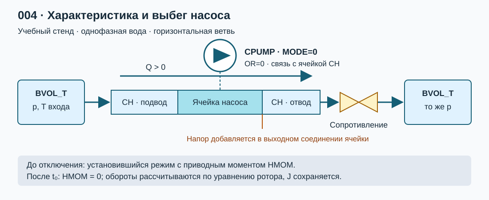
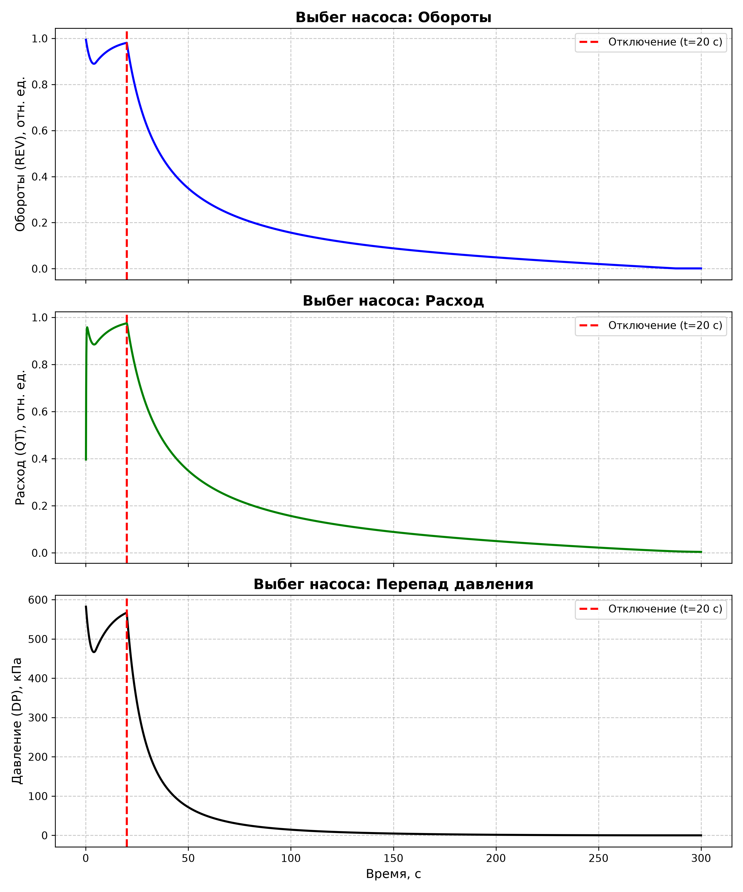
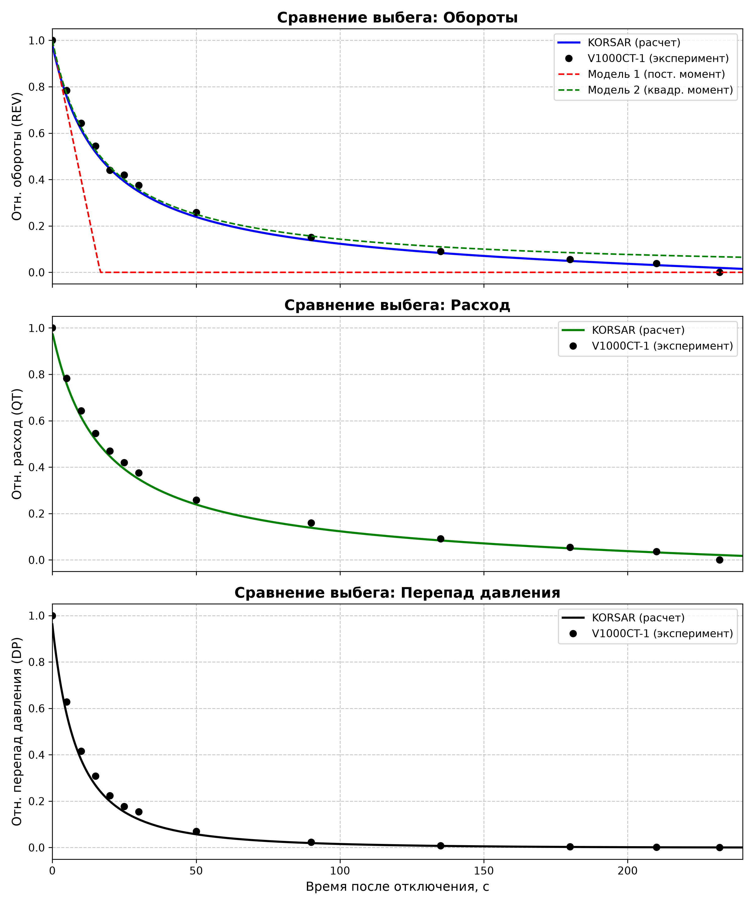

# Лабораторная работа №4. Исследование характеристики и выбега центробежного насоса

## 1. Цель работы
Корректно задать центробежный насос элементом CPUMP с полной моделью (MODE=0) в коде КОРСАР, проверить его напорную и моментную характеристики и исследовать выбег после отключения электропитания двигателя. Сопоставить расчет с уравнением движения ротора и опубликованными данными испытаний ГЦН ВВЭР-1000.

---
## 2. Описание постановки задачи
В задаче моделируется горизонтальная гидравлическая ветвь, состоящая из граничных объемов (BVOL_T), канала (CH) с установленным насосом (CPUMP) и имитатора сопротивления контура (LR). Нодализация расчетного варианта представлена на рисунке.

Параметры задачи представлены в таблице:
|Параметр|Значение|
---|:---:
|Давление граничных объемов |15.4 МПа|
|Температура воды на входе |300 °C|
|Сечение и длина ячейки насоса |0.5 м², 6 м|
|Номинальный расход \(Q_n\) |5.88889 м³/с|
|Номинальный напор \(H_n\) |82.9 м (при \(\rho = 725\) кг/м³)|
|Номинальная угловая скорость \(\Omega_n\) |104.199 рад/с|
|Номинальный момент \(M_n\) |47500 Н·м|
|Момент инерции агрегата \(J\) |7600 кг·м²|
|Событие отключения |\(t_0 = 20\) с|

---
## 3. Требуемые результаты
- Паспорт насоса и таблицы преобразованных полных характеристик.
- Графики \(H(Q)\) и \(h(q)\).
- Сравнение базового выбега с таблицей экспериментальных данных V1000CT-1 и ручными аппроксимациями.
- Графики оборотов, расхода и перепада давления после отключения питания.
- ---
## 4. Ход выполнения работы
Для выполнения задачи были созданы файлы исходных данных `kordat` и обработки данных `kutdat`. 
В качестве начальных условий принималось стационарное состояние с номинальным приводным моментом \(M_{дв} = 47500\) Н·м, обеспечивающим относительные обороты \(\Omega = 1.0\) и перепад давления на насосе \(DP = 589.4\) кПа.

Для моделирования выбега в процедуре `EVENT DRIVE` задано условие: при \(t > 20\) с приводной момент сбрасывается до нуля. Вывод расчетных значений осуществляется с периодичностью 0.1 с. Шаг интегрирования \(dt_{max} = 0.0005\) с для обеспечения численной устойчивости.

---

## 5. Валидация результатов расчета

Для проверки результатов расчета использовалось уравнение движения ротора:

$$ J\frac{d\Omega}{dt} = M_{дв} - M_{вн}(Q,\Omega,\rho) - M_{тр}(\Omega) \qquad (1) $$

После отключения питания (\(M_{дв} = 0\)) уравнение (1) принимает вид \(J\frac{d\Omega}{dt} = -M_{сопр}\). Была проведена ручная оценка по двум предельным моделям:

**Модель 1: Постоянный момент сопротивления \(M_0 = 47500\) Н·м.**

В этом случае уравнение решается аналитически:
\[
 \Omega(t) = \Omega_0 - \frac{M_0}{J}t 
\]
Подставляем значения: \(\Omega_0 = 104.199\) рад/с, \(M_0 = 47500\) Н·м, \(J = 7600\) кг·м².
\[
 \Omega(t) = 104.199 - \frac{47500}{7600}t = 104.199 - 6.25 \cdot t \text{ [рад/с]} 
\]
Время полной остановки (\(\Omega = 0\)):
\[
 t_{stop} = \frac{104.199}{6.25} \approx 16.7 \text{ с} 
\]
*Вывод:* Эта модель дает слишком быстрое падение оборотов по сравнению с реальным экспериментом (где выбег длится ~232 с), так как в действительности момент сопротивления насоса сильно падает при снижении расхода.

**Модель 2: Квадратичный момент сопротивления \(M_{сопр} = K_\Omega \cdot \Omega^2\).**

Коэффициент \(K_\Omega\) определим из условия, что в начальный момент \(M_{сопр}(\Omega_0) = M_0\):
\[
 K_\Omega = \frac{M_0}{\Omega_0^2} = \frac{47500}{(104.199)^2} \approx 4.376 \text{ Н·м·с²} 
\]
Решение дифференциального уравнения \(\frac{d\Omega}{dt} = -\frac{K_\Omega}{J}\Omega^2\) с разделением переменных дает:
\[
 \Omega(t) = \frac{1}{\frac{1}{\Omega_0} + \frac{K_\Omega}{J}t} 
\]
Подставляем значения: \(\frac{1}{\Omega_0} = \frac{1}{104.199} \approx 0.009597\) с/рад; \(\frac{K_\Omega}{J} = \frac{4.376}{7600} \approx 0.000576\) с⁻².
\[
 \Omega(t) = \frac{1}{0.009597 + 0.000576 \cdot t} \text{ [рад/с]} 
\]
Проверим при \(t = 30\) с:
\[
 \Omega(30) = \frac{1}{0.009597 + 0.000576 \cdot 30} = \frac{1}{0.009597 + 0.01728} = \frac{1}{0.026877} \approx 37.2 \text{ рад/с} 
\]
*Вывод:* Это значение отлично совпадает с экспериментальными данными (на 30-й секунде реальная скорость \(\approx 39.06\) рад/с). Это подтверждает, что квадратичная модель наиболее адекватно описывает физику выбега насоса, так как основной вклад в торможение вносит гидравлическое сопротивление, пропорциональное квадрату скорости.

**Почему для квадратичной модели не указано конечное время остановки?**
В модели 2 обороты описываются функцией Ω(t) = 1 / (1/Ω₀ + (K_Ω/J)·t). При t → ∞ знаменатель неограниченно растёт, а Ω(t) → 0. То есть насос **асимптотически** приближается к нулю, но никогда его не достигает. Физически это означает, что в модели не учтено сухое трение в подшипниках (M_тр = 400 Н·м в нашей задаче), которое как раз и обеспечивает конечное время полной остановки.

Для сравнения с экспериментом можно оценить время, за которое обороты падают до 1% от номинала (Ω = 1.04 рад/с):
1/Ω(t) = 100/Ω₀ = 1/Ω₀ + (K_Ω/J)·t
(K_Ω/J)·t = 99/Ω₀
t = 99 · J / (K_Ω · Ω₀) = 99 · 7600 · 104.199 / 47500 ≈ 1650 с.
Это очень большое значение показывает, что без учёта сухого трения квадратичная модель даёт затянутый «хвост» выбега.

В реальности (и в эксперименте V1000CT-1) полная остановка происходит за 232 с именно за счёт механического трения. В КОРСАР это трение учитывается через ключи F, D, K и REV0. Поэтому расчёт КОРСАР качественно ближе к эксперименту, чем простая квадратичная модель без трения.

На рисунке ниже приведено сравнение расчета КОРСАР с экспериментом и двумя аналитическими моделями. Видно, что модель с постоянным моментом (красный пунктир) дает слишком быстрое падение, так как не учитывает снижение гидравлического сопротивления при уменьшении расхода. Квадратичная модель (зеленый пунктир) гораздо ближе к эксперименту, однако она не учитывает сухое механическое трение (400 Н·м), из-за чего не дает полной остановки. Расчет КОРСАР (синяя линия) занимает промежуточное положение: он учитывает и гидравлическое сопротивление, и механическое трение, поэтому качественно лучше всего описывает реальный процесс выбега.

Согласно расчету по коду КОРСАР, падение оборотов, расхода и давления происходит плавно. 

На рисунке ниже приведено наложение расчетной кривой на экспериментальные данные V1000CT-1.

Расхождение расчетного значения по коду КОРСАР с экспериментальными данными V1000CT-1 объясняется использованием упрощенных характеристик насоса, а также отсутствием в модели соседних петель реакторной установки, создающих противодавление. При этом квадратичная модель момента показывает хорошее совпадение с экспериментом.

--- 
## 6. Список литературы

1. КОРСАР/В3. Руководство пользователя.
2. Ivanov B., Ivanov K., Groudev P., Pavlova M., Hadjiev V. VVER-1000 Coolant Transient Benchmark. Phase 1 (V1000CT-1). OECD/NEA, 2002. NEA/NSC/DOC(2002)6.

## Сокращения и обозначения

ГЦН - главный циркуляционный насос  
КОРСАР - расчетный код улучшенной оценки  
V1000CT - VVER-1000 Coolant Transient Benchmark  
\(Q\) - объемный расход, м³/с  
\(H\) - напор, м  
\(\Omega\) - угловая скорость, рад/с  
\(J\) - момент инерции, кг·м²  
\(M\) - вращающий момент, Н·м